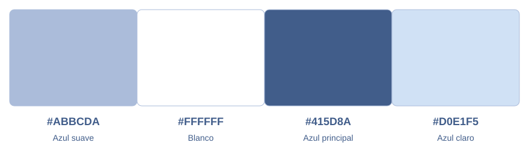

# Paleta visual de OroBest Sign

Colores tomados de los códigos hexadecimales de la imagen proporcionada por el propietario.



| Color | Código | Uso principal |
| --- | --- | --- |
| Azul suave | **`#ABBCDA`** | Bordes, separadores y detalles decorativos |
| Blanco | **`#FFFFFF`** | Fondo general, tarjetas y campos; texto de botones principales |
| Azul principal | **`#415D8A`** | Botones principales, títulos, texto, iconos y foco |
| Azul claro | **`#D0E1F5`** | Botones secundarios, selección y superficies de apoyo |

## Aplicación en Compose Multiplatform

- Los cuatro valores exactos están centralizados en `core/designsystem/theme/OroBestPalette.kt`.
- `OroBestTheme.kt` los conecta con los tokens de Composables UI y conserva sus formas y efectos adaptativos.
- `App` ya utiliza `OroBestTheme` como tema compartido entre Android, iOS y JVM.
- La paleta se aplica como tema claro para respetar la referencia.
- Las futuras pantallas deben usar tokens semánticos de `Theme[colors]`, evitando repetir valores hexadecimales.

Ejemplo de selección de color en un componente:

```kotlin
val actionColor = Theme[colors][primaryColor]
val actionTextColor = Theme[colors][onPrimaryColor]
```

## Combinaciones de texto

- Blanco sobre azul principal: contraste **6,65:1**.
- Azul principal sobre blanco: **6,65:1**.
- Azul principal sobre azul claro: **4,99:1**.
- El azul suave se reserva para bordes y decoración; no para texto pequeño sobre blanco ni para fondos de texto de lectura.

La superposición de modales usa el azul principal con 32 % de opacidad. Los errores/acciones destructivas conservan los colores semánticos de Composables UI para diferenciarlos de las acciones normales.

La paleta queda preparada para la siguiente etapa de diseño de pantallas.
